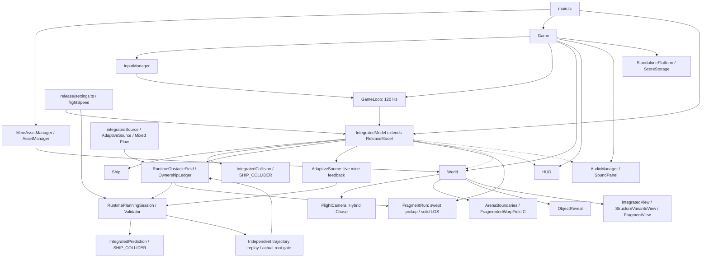

# Архитектура Space Runner

Документ отражает выбранную владельцем production-архитектуру RELEASE-007 на основе a5906ef. Схема разделяет authoritative симуляцию, безопасную публикацию и представление.

Обычный запуск в main.ts создаёт MineAssetManager, IntegratedModel и Game. В public build нет window.spaceRunner и исследовательских селекторов. Имена каталогов debug и experiments сохраняют историю разработки: используемые из них классы входят в обычный production-граф.

IntegratedModel наследует ReleaseModel, RuntimeGameModel и GameModel. Он связывает integratedSource с Balanced AdaptiveSource, существующим Mixed Flow, RuntimeObstacleField и OwnershipLedger. GameLoop передаёт ввод с фиксированным шагом 120 Гц. Одна пара beginPlanningFrame/finishPlanningFrame ограничивает работу планировщика на render-интервал; редкий рендер может вызвать безопасный пропуск будущей секции.

RuntimePlanningSession проверяет полную известную геометрию, включая реактивную мину и составной SHIP_COLLIDER. Независимый replay и gate из настоящего текущего состояния предшествуют атомарной публикации. Отказ или незавершённая работа не публикуют препятствие. Бюджеты, запасы реакции и collision margins в RELEASE-007 не меняются.

Ship использует общую форму: корпус r0.42; крылья ±1.08/-0.30/0.70, r0.18. IntegratedCollision и IntegratedPrediction используют тот же профиль. Визуальный крен не поворачивает физические сферы. AdaptiveSource обновляет фактическое состояние мины после движения Ship; её инерция, предупреждение и swept CCD участвуют в прогнозе и replay.

FragmentRun размещает необязательные Energy Fragments только после успешной публикации поля. Swept pickup и LOS по твёрдым частям станции сохраняют помощь 1.10 для корпуса и0.96 для крыла. FragmentView показывает140мс магнитную анимацию; счётчик потребляется HUD и AudioManager без дополнительной экономики.

release/settings.ts задаёт порог500м, множитель1.08 и48м дополнительного интервала некоторых коротких секций Phase1. Общий flightSpeed используется и живой моделью, и прогнозом/replay. Уже опубликованное поле не перестраивается при переходе фазы.

World получает состояние для показа. FlightCamera использует80% Hybrid Chase с неизменными FOV и оптикой. ArenaBoundaries показывает только FragmentedWarpField C: одна ribbon-геометрия/материал, движение по дистанции, proximity и геометрическое исключение пересечений с реальными станциями. ObjectReveal использует simulation elapsed и общие material cohorts для плавного появления и depth haze. IntegratedView показывает станции и GLB мины; FragmentView, EngineVFX и ImpactVFX владеют своими ресурсами.

Game владеет HUD, InputManager, AudioManager, SoundPanel, World и lifecycle. Пауза, потеря фокуса, рестарт и dispose сохраняют общий граф ресурсов и единственный AudioContext. SoundPanel меняет Master/Music/SFX/mute; StandalonePlatform и ScoreStorage сохраняют настройки/рекорд локально. Нет backend и зависимости игровой логики от будущего Yandex SDK.

Источники: src/main.ts, game.ts, integrated/, release/, core/, debug/runtime-field.ts, experiments/adaptive-homing/, collectibles/, camera/, visuals/, audio/.
