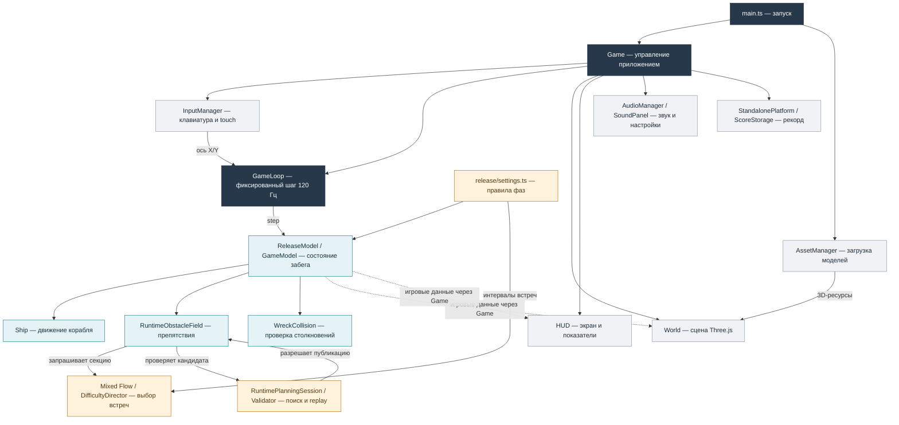

# Архитектура Space Runner

Space Runner — браузерная 3D-игра на TypeScript, Three.js и Vite. Корабль автоматически летит вперёд, игрок управляет его положением по горизонтали и вертикали, а игровой мир создаёт препятствия по мере прохождения дистанции. Архитектура разделяет игровую логику, генерацию препятствий, графику, ввод и звук: правила игры рассчитываются независимо от того, как сцена выглядит на экране.

Документ описывает **публичную версию из `main`** после практической работы №2 (`0b48599`). Позднейшие правки README и CHANGELOG не меняют описанную игровую архитектуру.

## 1. Общая схема

Сплошные стрелки показывают вызовы и использование подсистем. Пунктирные — передачу состояния для отображения. Диаграмма намеренно объединяет некоторые классы в логические блоки, чтобы оставаться читаемой; это не отдельные классы с выдуманными именами.

## 2. Основные компоненты

| Компонент | Расположение | Назначение |
|---|---|---|
| Загрузка приложения | `src/main.ts` | Предзагружает ресурсы, создаёт `ReleaseModel` и экземпляр `Game`, подключает визуализацию станций. |
| `Game` | `src/game.ts` | Связывает управление, игровой цикл, модель, графику, HUD, звук и сохранение рекорда; обрабатывает кнопки Play, Pause, Resume и Restart. |
| `GameLoop` | `src/game-loop.ts` | Использует `requestAnimationFrame` для отрисовки, а состояние игры обновляет с фиксированным шагом 1/120 секунды. |
| `InputManager` | `src/input.ts` | Преобразует клавиши и сенсорный ввод в направление управления кораблём по X/Y. |
| `GameModel` | `src/core/game-model.ts` | Хранит состояние игры, корабль, дистанцию, прочность корпуса и временную неуязвимость. Обновляет движение и определяет столкновения. |
| `ReleaseModel` | `src/release/model.ts` | Соединяет базовые правила игры с опубликованным смешанным полем и двумя фазами сложности. Наследуется от `RuntimeGameModel`, который, в свою очередь, расширяет `GameModel`. |
| `Ship` | `src/core/ship.ts` | Рассчитывает положение и скорость корабля по действиям игрока. |
| `RuntimeObstacleField` | `src/debug/runtime-field.ts` | Подготавливает секции, хранит активные препятствия, вызывает планирование и публикует только проверенные конфигурации. |
| `Mixed Flow` / `DifficultyDirector` | `src/experiments/mixed-flow/source.ts`, `src/core/field-director.ts` | Выбирают типы встреч, обычные астероиды, пространственные паттерны и периодические обломки станции с разными проёмами. |
| `RuntimePlanningSession` и валидатор | `src/core/field-runtime-session.ts`, `src/core/field-validator.ts` | Проверяют конфигурации препятствий на достижимость безопасной траектории, затем повторно воспроизводят найденный маршрут перед публикацией. |
| `WreckCollision` | `src/experiments/structure-variants/profile.ts` | Выполняет непрерывные проверки столкновений, включая составные коллайдеры станций с настоящими проёмами. |
| `World` и визуализация станций | `src/world.ts`, `src/experiments/structure-variants/view.ts` | Рисуют корабль, астероиды, станции, фон и визуальные эффекты через Three.js. |
| `HUD` | `src/ui.ts` | Отображает дистанцию, корпус, состояние меню и паузы, текущую фазу и уведомление о переходе. |
| Аудиосистема | `src/audio/` | Управляет фоновой музыкой, звуками событий, отключением звука и тремя отдельными уровнями громкости. |
| Рекорд | `src/services/platform.ts`, `src/services/storage.ts` | Сохраняет лучший результат локально в браузере через платформенный адаптер. |

## 3. Как проходит игровой кадр

В браузере `main.ts` загружает 3D-модели и создаёт `Game`. Когда игрок нажимает **Play**, начинается новый забег: модель сбрасывает положение корабля, дистанцию, прочность и состояние препятствий.

`InputManager` собирает управление. `GameLoop` передаёт его в модель через `step` с фиксированным шагом **120 Гц**. `GameModel` перемещает корабль, увеличивает пройденную дистанцию, обновляет препятствия и проверяет столкновения. Попадание отнимает одну единицу корпуса; после третьего попадания состояние становится `GAME_OVER`.

Отрисовка выполняется отдельно: `Game` передаёт обновлённое состояние в `World`, `HUD` и `AudioManager`. Графика не определяет физику — например, положение меша не используется как первичный источник истинного состояния корабля.

При паузе модель переходит в `PAUSED`: игровой цикл продолжает обслуживать интерфейс и отрисовку, но игровой `step` перестаёт изменять дистанцию и положение объектов. После продолжения обновления возобновляются с сохранённого состояния.

## 4. Генерация и проверка препятствий

В публичной игре используется **Mixed Flow** — непрерывное поле из обычных астероидов, различных пространственных комбинаций и крупных фрагментов станции. `DifficultyDirector` определяет очередность и интенсивность встреч. Для станций автоматически меняется расположение отверстия: по центру, слева, справа, сверху или снизу.

Новая секция не добавляется в игровой мир сразу. Сначала `RuntimeObstacleField` получает кандидата от генератора и передаёт его в `RuntimePlanningSession`. Валидатор рассчитывает, существует ли безопасный маршрут с учётом настоящей динамики корабля, ранее размещённых препятствий и ограниченного времени реакции. Затем найденная последовательность действий проверяется повторным воспроизведением — **replay**.

Только после успешной проверки секция целиком публикуется в игровом поле. Если поиск не успел найти подходящий путь либо повторная проверка не прошла, система может использовать отдельно проверенную альтернативу или пропустить секцию. Так сохраняется корректность столкновений, хотя иногда это создаёт более свободные участки.

Крупные станции не считаются сплошными блоками: их твёрдые части представлены четырьмя составными коллайдерами вокруг свободного прохода. Проверки столкновений выполняются непрерывно, чтобы быстрый пролёт не пропустил контакт между двумя соседними обновлениями.

## 5. Фазы и сложность

Правила публичной версии находятся в `src/release/settings.ts`, а применяются через `ReleaseModel`.

| Параметр | Фаза 1 | Фаза 2 |
|---|---|---|
| Условие | От начала забега до 500 м | С 500 м до гибели корабля |
| Скорость | Текущая базовая кривая скорости | Та же кривая × **1,08** |
| Интервалы встреч | После некоторых коротких секций добавляется 48 единиц свободного пути | Дополнительные 48 единиц убираются |
| HUD | `PHASE 1 / NORMAL FLIGHT` | `PHASE 2 / DANGEROUS SECTOR` и короткое уведомление |

Фаза определяется по пройденной дистанции, а не по отдельному таймеру. При паузе дистанция не увеличивается, поэтому фаза не меняется. При новом забеге прогресс сбрасывается.

Оба параметра влияют на настоящую симуляцию: скорость используется как при движении корабля, так и в прогнозе валидатора; изменение интервалов влияет на следующие генерируемые секции. Уже опубликованные объекты при переходе во вторую фазу не перестраиваются.

## 6. Графика, звук и сохранение

За графику отвечает `World`, использующий Three.js и ресурсы из `AssetManager`. Он отображает корабль и препятствия, обновляет камеру, звёздный фон, выхлоп двигателей и эффекты повреждений. Для обломков станции публичная версия повторно использует `StructureVariantsView`, но без отладочной панели.

`HUD` получает значения из модели через `Game`. Он показывает дистанцию, оставшуюся прочность, текущую фазу, меню паузы и экран завершения забега. Логика столкновений от текста на экране не зависит.

`AudioManager` управляет звуком двигателя, музыкой и звуковыми эффектами. `SoundPanel` позволяет изменять **Master**, **Music** и **SFX**, а также включать mute. Эти настройки сохраняются в браузере. Отдельно `StandalonePlatform` использует `ScoreStorage` для сохранения лучшей дистанции.

## 7. Границы публичной версии

В репозитории есть отдельные исследовательские модули, в том числе линейные, диагональные, Target-Lock и адаптивные самонаводящиеся мины. **В публичной игре через обычную кнопку Play самонаводящиеся мины не активированы**: для них ещё остаются вопросы производительности и частоты успешной публикации. Эти эксперименты намеренно не показаны на схеме основной игровой архитектуры.

Несмотря на название каталогов `src/debug` и `src/experiments`, некоторые ранее экспериментальные компоненты — например, `RuntimeObstacleField` и `Mixed Flow` — сейчас используются в публичной модели `ReleaseModel`. Граница между релизом и DEV определяется фактическими подключениями в `main.ts`, а не только названием папки.

## 8. Основные архитектурные свойства

- **Разделение логики и визуализации.** Состояние игры рассчитывается моделью, а отображается через `World` и `HUD`.
- **Фиксированный шаг физики.** Обновления движения и столкновений выполняются с одинаковым шагом независимо от частоты кадров отрисовки.
- **Детерминированная генерация.** Последовательности препятствий воспроизводятся по seed и состоянию генератора.
- **Проверка перед публикацией.** Новые конфигурации должны пройти поиск безопасной траектории и повторное воспроизведение.
- **Централизованные правила фаз.** Скорость и интервалы встреч задаются отдельно от интерфейса.
- **Модульная инфраструктура.** Рендер, ресурсы, аудио и платформа хранения не определяют физические правила.

Основной технический компромисс — стоимость планирования: поиск безопасных маршрутов делает генерацию надёжнее, но иногда пропускает секции и вызывает кратковременные задержки кадра. Это известное ограничение текущей реализации.
