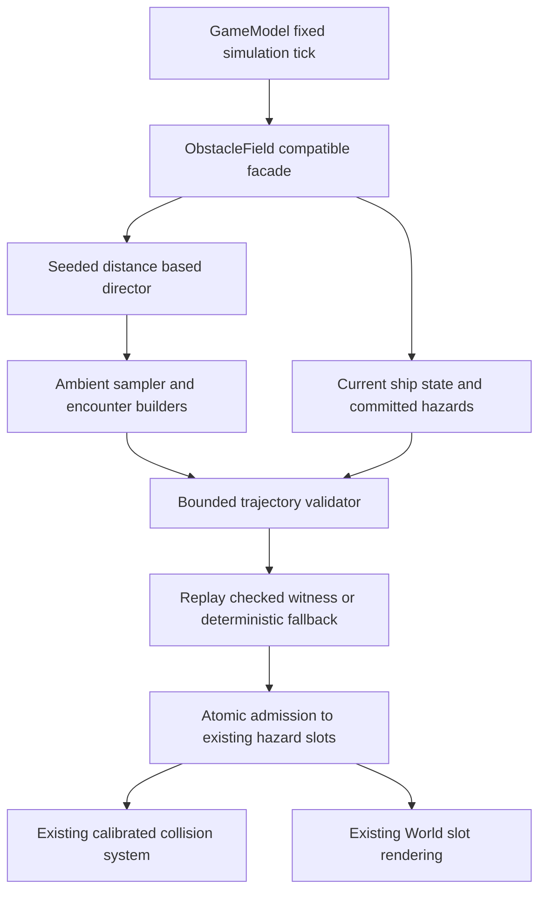

# Continuous field architecture — proposal for external review

Status: **GAMEPLAY-001A research only; GAMEPLAY-001B requires independent approval.** The audited baseline is [documented separately](CURRENT_GENERATOR_AUDIT.md). No types/modules below have been added to the runtime.

## Alternatives and recommendation

| Criterion | A: jittered waves | B: continuous stream | C: stream + small pattern library |
| --- | --- | --- | --- |
| Variety | Removes coplanarity; risks retaining fixed XY holes | Broad natural placement; weak intentional maneuvers | Natural flow plus deliberate spatial choices |
| Fairness | Old corridor proof fails as planes overlap; needs joint validation | Needs temporal/stateful validation | Same validator; patterns add candidate constraints |
| Runtime cost | Low placement cost; validation dominates | Low placement cost; validation dominates | Slightly more bounded candidate work |
| Determinism | Easy seed-only placement | Distance-indexed independent draws | Distance/epoch/pattern-indexed draws plus explicit state veto |
| Current compatibility | Smallest field edit, but preserves wave assumptions | New scheduling; same hazard/render contract | Same scheduling as B; four small data builders |
| Migration | Low initially; may need another redesign | Moderate | Moderate, can ship B-shaped foundation first |
| Testing | Must expose residual wall/stripe behavior | Distribution + seam + safety fixtures | Those plus pattern/transition fixtures |
| Extensibility | Limited without dissolving waves | Good catalog/motion extension | Good catalog/motion and encounter extension |
| Simplicity | Smallest patch; insufficient by itself | Simplest viable new generator | Recommended with exactly three policy roles, not a content framework |

Recommend **C**, with B as its foundation and a strict cap of four initial encounter intents. Evidence against A includes the permanent X stripes: Z offsets alone cannot close them. B is a valid fallback scope if pattern validation or mobile budgets fail review; it still needs the same real fairness validation. Neither scatter nor authored templates are safe merely by construction.

## Responsibilities and proposed data flow



Keep `ObstacleField` as GameModel's narrow facade. Proposed files are `core/field-generator.ts` (stream/candidate/pool admission), `core/field-director.ts` (pacing), `core/field-patterns.ts` (four small builders) and `core/field-validator.ts` (shared dynamics/collision planning). Types may initially live beside the generator. Avoid an ECS, plugin registry, pathfinding service, physics engine or scene dependency.

The facade retains `reset(seed)`, reusable `hazards` and `update(...)`; update would additionally receive the actual ship state/current normalized input and run time. Retire production `waves/safeX` after dependent fixtures migrate. World already consumes only hazards, so its camera, slot transforms and asset ownership need no rewrite. Stable IDs are additional logical metadata, never renderer objects.

Proposed planning records:

```ts
// Design notation only, not shipped declarations.
type PlannedHazard = {
  id: string; passDistance: number; x: number; y: number;
  radius: number; kind: number; phase: number; spin: number;
  collisionProfile: string;
};
type FieldContext = {
  elapsed: number; distance: number;
  ship: { x: number; y: number; vx: number; vy: number };
  input: { x: number; y: number };
  committed: readonly PlannedHazard[];
};
```

`passDistance` is distance at which a fixed obstacle's center crosses the ship plane; derive render/collision `z = currentDistance − passDistance`. This prevents “one Z per group.” Future nonstatic motion would supply a shared pose-at-time function; this task does not add it. A stream cell is only a 24-unit ownership interval, not a visible synchronized spawn batch. One planning transaction reserves 2–6 adjacent cells (48–144 units), enough for the longest initial pattern. It publishes all certified, independently placed depths atomically and advances the ownership frontier by the reserved span. Adjacent transactions share separation checks and committed context.

## Ambient field and encounters

Sample XY over the whole allowed center range, initially X[−5.4,+5.4]/Y[−3.15,+3.15], with radius-aware boundary/separation filtering; no lane quantization or permanent reserved X band. Candidate bounds are proposal settings, not production changes. Allow partial protrusion outside ship-center bounds when a usable interior alternative exists. Retain current radius range and assets for B; a separate later task may expand them.

Use bounded stratified distance gaps rather than an unbounded Poisson process: proposed ambient gaps 12–36 units in normal pacing, modulated by a target rate and checked across cell seams. Do not force equal counts per cell. Density is objects per traveled distance, independent of rendering dt. Radius-aware minimum 3D center separation starts at `r_i+r_j+0.3`; this uses conservative outer radii for **object separation only**. Ship safety uses full calibrated profiles. Reject excessive local coplanarity/near-plane clustering; do not add tiny decorative offsets to an otherwise flat barrier.

Ambient and encounter objects consume a **single total density/slot budget**. During a pattern, reduce ambient candidates in its occupied volume; never validate them separately and then union unchecked. Select patterns with seeded weights, cooldowns and compatible entry/exit intent. Templates describe multi-depth geometry, not a corridor the player must follow. The [pattern library](ENCOUNTER_PATTERN_LIBRARY.md) is deliberately small.

## Lifecycle and determinism

1. Advance existing hazards using the unchanged forward-motion contract; despawn behind +8.
2. Advance a distance-indexed generation frontier. Director parameters depend only on seed and simulation progression. Use half-open cells `[24k,24(k+1))` for ownership and fixed IDs `(version,cell,localIndex)` to avoid duplicates.
3. Build candidates in private bounded buffers. Key separate local RNG streams by seed/version/cell/purpose/attempt; specify a stable integer mixer in B and golden-test it. The existing LCG can fill each independently seeded stream. Never consume an unbounded shared RNG retry loop or renderer randomness.
4. Validate committed nearby obstacles **plus** the candidate from the actual position/velocity; certify a tail beyond the furthest committed collision interval.
5. On publication, replay the witness from the current state/time, not a stale planning snapshot. Reserve all needed pool slots before changing any record. Commit atomically, or keep the prior field intact.
6. Bounded candidate simplification and a safe omission fallback preserve an existing valid continuation. If the player has already made the committed field unreachable, report that state; adding no obstacle cannot rescue a past mistake. Never erase visible hazards, teleport the player or consume invulnerability to pass validation.

**Important reproducibility policy:** director choices and candidate proposals are seed/progression-only; actual-state safety vetoes make the accepted layout depend on the input history. Full replay therefore needs seed + generator version + fixed-tick inputs (or exact publication-state snapshots). A seed alone reproduces the proposal stream, not necessarily the accepted world after different steering. This is a deliberate recommendation requiring review, not a claim of preserving old seed-only layout semantics. The [fairness policy](PROCEDURAL_FAIRNESS.md) explains the tradeoff and alternative.

## Catalog and capacity

Proposed metadata is one small table: `typeId`, existing `visualId`, `collisionProfileId`, radius range, weight, minimum progression, allowed patterns, boundary/separation constraints. Start with the existing five variants. Current kind/phase mapping must remain compatible while migrating; do not assign a new visual ID that the unchanged World would render as another collider. Decoupling explicit visual variant from phase is a separately tested data migration, not a new asset acquisition.

Use existing 72-record allocation; proposed hard admission limit **32 active hazards**, soft target 24, including every visible/committed/planning-reserved slot. Candidate buffers and validator arrays also have fixed bounds. No obstacle may be silently dropped after certification because of pool exhaustion. Keep density initially comparable or lower than the current 9.71 hazards/100 steady-state; continuity, XY coverage and intent should improve engagement before raising count. More visible models may still cost more draws: benchmark on real devices before accepting 32.

Planning must finish ahead of visible commitments. Initial targets are a 128-unit lead to the first unpublished center, a 48–144-unit transaction, ≤15s horizon, 16-unit empty tail and fixed 144-tick (1.2s) publication deadline. The smallest transaction represents 1.412s of travel at speed34, exceeding the deadline; a serial planner can therefore keep pace in the propagation-count budget. Query cost/real hardware still need measurement. These are **proposed budgets** derived in the fairness document, not new production spawn settings. Bootstrap uses gentle, easily certified candidates and must not insert an initial empty planning-horizon flight or delay Launch. If bootstrap, sustained throughput or budgets fail, B cannot pass integration acceptance.

Future near-miss measurement can observe stable hazard IDs and logical separation along real trajectories; offer optional tighter routes beside certified safer ones. Do not optimize generation for bonuses or add rewards now. Future drifting/crossing objects must provide a time-bounded pose and enlarge broad-phase intervals; rotated boxes already need actual orientation over time. An unrecognized motion/profile must be rejected until its conservative prediction is implemented.

## Review gates

The major open questions are validator cost on phones, stale-root replay rejection, state-veto exploitability, bootstrap pacing and human readability of overlapping depths. Do not label the design proven, implemented, faster or more fun. [The test plan](GENERATOR_TEST_PLAN.md) defines measurable gates; [the B roadmap](GAMEPLAY_001B_IMPLEMENTATION_PLAN.md) orders the work.
