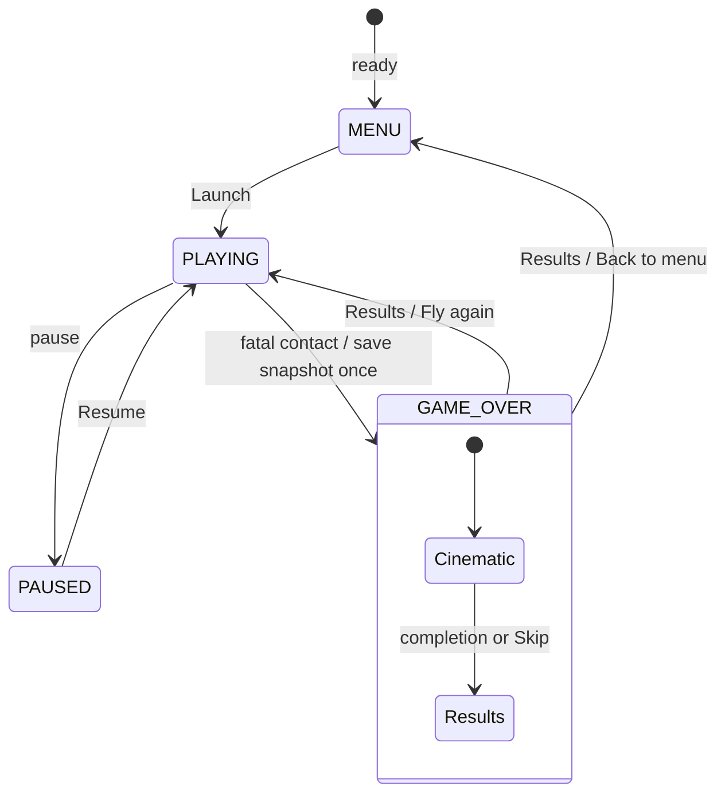

# State transitions and ownership

Before: MENU -> PLAYING <-> PAUSED; fatal contact -> GAME_OVER with existing presentation-only cinematic; completion/skip reveals results; Fly again -> PLAYING. New: completed results -> MENU -> PLAYING. GAME_OVER remains the model state throughout cinematic and results; no additional gameplay state is invented.

run.started captures the current platform best into RunResults for this runId. Model.setRecordBaseline still receives the same best and score.recordBroken still fires through existing feedback. At the first GAME_OVER sync, finish freezes final score/energy/seed plus strict comparison with pre-run best and calls the unchanged store once. Repeated finish for that runId and stale runIds are ignored. The snapshot survives cinematic completion/skip; begin resets it on replay, clear resets it after returning to menu. Equal/lower/zero results are not new records. Storage-denied behavior remains the existing in-memory best fallback; reload persistence only applies where storage works.

The existing cinematic starts from the real fatal event. Results stay hidden while it is active; Skip owns focus. Natural finish or Skip updates presentation to the same snapshot and focuses Replay. Existing sequence timing, camera, fragment breakup, reduced-motion shortening and audio cues are untouched. The pending-results cue is cleared on menu navigation before sync, preventing an obsolete cue. The new label has no timed reveal callback.

returnToMenu rejects states other than GAME_OVER; the Game handler also rejects an active cinematic. It resets ship/field/elapsed/distance/invulnerability/hull and queued facts, not runId or saved best. Field.reset cancels pending work using the existing implementation; ReleaseModel additionally clears fragments and collision transient data. No run starts, end event, score write or simulation is performed in MENU. Game clears input, audio run voices/transients, coordinator and world presentation with existing reset functions, then syncs MENU and calls existing audio.activate. Sound preferences/context/decoded samples/score sources remain owned by the same audio graph.

Fly again uses the existing start path and seed policy, resetting distance, energy, HP, input, audio/world/feedback and setting the next model baseline. A new guard rejects duplicate starts while playing, paused or cinematic-active; normal pause Restart retains its existing separate handler. Back and Replay are one native button activation; no confirmation or reload.

Focus: MENU/Back -> Launch; PLAYING/Replay -> canvas; PAUSED -> Resume; active death -> Skip; results -> Fly again. Tab/Shift+Tab follow visible native buttons; canvas has tabindex=-1 outside gameplay. Existing sound-dialog focus/Escape handling is retained; Escape on results has no new meaning. Enter/Space still skip only during active cinematic; normal button activation works afterwards. Input.clear runs on state transitions and menu entry, so a held previous-run key does not steer a newly launched flight. No new subscriptions or timers are added by RunResults or navigation.
