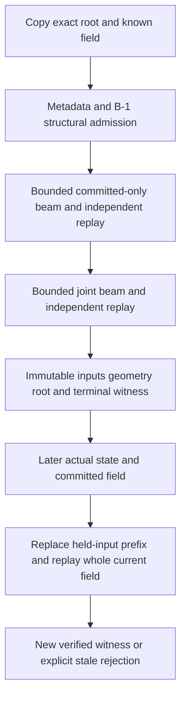

# Trajectory validation — isolated B-2

Baseline: `90b2b103ff4fa8f64953894679142b6def938f82`. Branch: `feature/gameplay-001b-trajectory-validator`. This is an isolated finite-witness validator, not a live generator, publication coordinator or proof of human fairness. All original gameplay modules remain byte-identical after checkout newline normalization. Existing tests and historical reports are unchanged.

## Modules

| Module | Responsibility |
| --- | --- |
| `field-validator-types.ts` | Experimental limits, strong result reasons, control runs, witness and metrics |
| `field-prediction.ts` | Reusable private actual Ship; exact forward step; search clock-table adapter; calibrated queries |
| `field-clearance.ts` | Isolated optional margin adapter over original sweep functions, profiles and orientation |
| `field-validator.ts` | Structural gate, exact-state beam, incremental lifecycle, independent replay and later-state check |
| `field-types.ts` | B-1 context extended only with optional exclusive reservation distance; minimal B-1 decision remains compatible |

Tests and research alone import the new runtime modules. No GameModel, ObstacleField, controls, camera, rendering, scoring, health, immunity, audio, VFX, UI, assets or dependency edit occurs. An initial shared collision extension failed an existing source-pinning test; it was removed rather than changing that assertion. Gameplay `HazardCollision` is untouched. The small margin adapter duplicates the original query orchestration but shares all actual sweep/pose/profile math; 10,000 frozen-baseline differential sweeps guard its zero behavior. Future changes to the gameplay orchestrator must also review this adapter.

## Exact prediction and geometry

Each state retains full-precision x,y,vx,vy,elapsed,distance. A private shadow Ship calls the real `Ship.update(1/120,input)`. Boundary clamping and velocity reset, component acceleration/braking and combined-speed normalization are unchanged. Forward ordering is lateral step, elapsed increment, `difficulty(endTime).speed`, distance increment, collision. Tests compare 10,000 transitions to GameModel, including its 120s speed-ramp boundary.

Forward clocks are input-independent. Preparation tabulates exact successive end-step time/distance additions, never an analytic integral. Search branches reuse these values; independent replay calculates them again through the ordinary predictor. Terminal states must match exactly. There is no state snapping or interpolation between different predecessors.

`q-D` supplies relative Z endpoints. Search skips a narrow query only when the entire swept axial interval lies outside `radius+0.42+margin`. Past opportunities are clipped by the same conservative test. Equality remains included. Narrow phase uses actual simultaneous outer-sphere AND oriented rounded-box CCD, absolute-time XYZ orientation and midpoint rotation allowance; the two round variants retain swept spheres. The optional adapter margin inflates only the player envelope in both conditions. Default experimental clearance is 0.15; it is not a human timing guarantee.

Replay starts from a fresh root and visits **every** hazard at **every** substep, with no search broad-phase filtering. It queries both the margin adapter and unchanged gameplay HazardCollision. Both queries are charged separately. It never reads recorded search-safe flags, health or immunity and never removes hazards. This checks both broad-phase mistakes and compatibility with actual gameplay geometry.

## Search and terminal contract

After 54 held-input steps (0.45s), expand nine normalized-by-Ship actions in 24-step macros (0.2s). Keep at most16 exact nodes; use 0.25-position/0.5-velocity bins only to prune, with at most two exact representatives per bin. Each retained node has its real predecessor and input run. Expansion holds at most144 nodes per layer; at most76 retained layers fit the 15s horizon.

The first local occupancy potential failed R05 despite a known safe alternating trace. The revised ranking samples a 7×5 grid of coarse goals around the next depth group and ranks progress toward those goals, velocity and control changes with stable serial ties. Goals are heuristic targets only, not legal state quantization, an encounter library or a safety certificate. All 120Hz transitions still pass real collision queries. Conservative outer-circle goal screening can discard useful narrow-profile approaches; finite-search false rejection remains possible.

The whole known field determines the last outer collision exit. The reaction prefix always runs in full. After the later of reaction completion and the last exit, apply **39 actual neutral Ship steps**, the ceiling of `(8/25)/(1/120)`. Require actual vx=vy=0 and legal XY. Reserve at least16 world units beyond the furthest center or reaction-end distance, whichever is later. End **inside** that reservation with room for a maximum future object's outer radius plus player/margin. Do not drive to its edge, truncate a far hazard, reset velocity or assume a terminal position implies a terminal velocity. A 15s overrun or inadequate reserve rejects explicitly.

The caller must supply every relevant known obstacle and honor the empty reservation in the actual future world. The isolated API cannot reserve slots or prevent an external caller from adding undisclosed content. This is a conditional certificate for the supplied set.

## Lifecycle, work and failures

`beginValidation` copies and freezes the root, geometry and settings. `advance` represents one strictly increasing logical planning tick. Generator continuations yield **before** each propagation or narrow query, so either counter can stop mid-macro or between a margin and gameplay query without overshoot. Hard caps are4096 propagations/8192 queries per tick and144 ticks per job; default chunks use3072/6144 for CPU reserve. Budget overrun/deadline rejects; no timeout accepts. Preparation is separately bounded by32 hazards and1800 clock entries per prepared context; its measured time is reported separately. Goal/pruning work is bounded but is not misleadingly counted as a narrow query.

At most two beams run: committed-only, then full union. Each successful beam is independently replayed before use. No unbounded retry, simplification, worker or scheduler exists. At most four replay slots are allowed per job; ordinary validation uses two and publication uses one in its separate job. A future coordinator must enforce its transaction-wide scheduling/publication budget, including these jobs, and select the reviewed fixed publication tick. Finishing a snapshot job early does not publish anything.

Failures distinguish structural input, unknown profile, held-input collision/insufficient response, no witness under bounded search, incomplete horizon/tail, computation limit, replay disagreement, existing-field uncertified and stale publication. Existing-field uncertified means the base could not certify this root; it does not prove every physical path impossible. Explicit synthetic-overlap policy is for R fixtures only; normal API applies real B-1 admission and capacity checks.

## Witness and later state

An accepted witness contains version, complete frozen root/context/provenance, clearance/policy, reservation, full run-length inputs, terminal state and a reproduction hash. Benchmarks additionally record SHA256 of complete JSON. The core FNV hash is noncryptographic and never authorizes acceptance. A fresh replay is always required; externally reconstructed controls must span the entire prefix, field and braking interval.

`beginPublicationCheck` checks candidate identity, monotonic later time/distance, ≤1.2s age and that candidate opportunities have not already started. It retains the later player's actual position/velocity, replaces the 54-step held-input prefix with current input, recomputes absolute times, all current committed hazards and terminal tail, then replays the stored relative action sequence. It can append neutral continuation or truncate it after the current field; no old endpoint is trusted. Collision or other failure returns explicit stale rejection. No replan or committed-geometry mutation occurs. Publication acceptance is a new witness from the later supplied root, not permission for live spawning.
