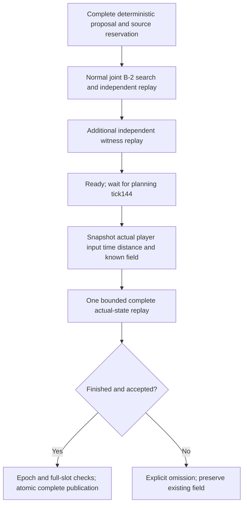

# Runtime publication — selected B-5A approach

Approved baseline: `d523cc4286d825594affbf9151cdae395b3ae721`. The new field is a developer prototype. Production and development without `?debug=field` retain the original wave generator.

## Why the B-4 oracle is not a runtime solution

B-4's prepared publication root can include144 future inputs supplied by its research driver. A human can change input after any planning snapshot. Holding the last input is only a forecast; equality failure must reject. Driving the actual ship along the offline witness or assigning a predicted endpoint would change the controls and conceal the stale-state problem. Neither occurs here.

The runtime API receives a current player/input/time/distance snapshot and complete known geometry. It has no tape, policy callback, preview method or future-root argument. A beam witness proposes *possible controls*, rather than predicting which controls the player will choose. Acceptance certifies existence of that route under the model; players remain free to abandon it.

## Alternatives and evidence

| Approach | Assessment |
| --- | --- |
| A: late actual-state replay | Selected. Prepare through normal B-2 validation, then replay from the actual publication root and commit synchronously in the same call. An incomplete final replay omits the candidate. |
| A with original full-query replay | Measured diagnostic:9/48 transactions commit under one default final-tick budget. Repeated queries against axially distant objects consume the query allowance. No budget is increased. |
| A with conservative axial culling |43/48 commit on the matched six8-section comparison sequences; the B-4 oracle also commits43/48, while held-forecast B-4 commits0/48. These sequences can diverge after omissions; they are policy comparisons, not identical-work microbenchmarks. |
| B: rolling replanning | Can make a witness more recent but cannot authorize a stale final result. Repeated full searches would compete with the two-search/shared144-tick ceiling. Not implemented; a bounded change of control proposal may be reviewed later. |
| C: robust state coverage | A finite collection of accepted roots does not cover the continuous position/velocity/input space. A conservative reachable envelope needs separate numerical bounds and capacity evidence. No such envelope is claimed. |
| D: worker preparation | A worker can move beam CPU off the render thread, but cannot know human input or replace the actual-state gate. No worker is implemented. Local rendered measurements support testing the smaller main-thread approach; longer/device measurements remain gates. |

The exact corpus and raw timings are in FAIRNESS_EVIDENCE and PERFORMANCE. Full-query rejection is a computation limit, not proof that geometry is physically impossible.

## Implemented transaction

Preparation must be ready before the publication call. That call spends no preparation chunk as well as the final replay. All phases share at most two searches/four replays and the144-call deadline. Default per-call ceilings remain3072 propagations/6144 queries; B-2 hard4096/8192, width16, horizon1800, margin0.15,54 held-input steps and39 neutral braking steps remain unchanged. A forecast is not used in RuntimePlanningSession.

The final job copies the actual state, recomputes absolute hazard poses and the complete union, replaces the reaction prefix with the actual held input, and independently integrates the remaining proposed controls and new braking tail. It retains B-2's relative control proposal; it does not assert the historical actions will remain useful. Collision, age/identity/warning, incomplete work, missing geometry or stale ownership causes rejection. An additional search or a later incremental proof is never smuggled into this final call.

## Axial query culling and exact guarantee

The original complete-query replay remains the differential oracle. Only the new runtime entry point enables axial culling. For each independently integrated120Hz step, a static hazard can be skipped only if its enclosing sphere is strictly outside the entire forward interval. The extent includes radius, ship radius and the unchanged margin, plus an outward numerical guard `1e-9 + 8*EPSILON*max(1,|q|,|D0|,|D1|)`. Equality stays included. Both calibrated margin and unchanged gameplay CCD are called for every remaining opportunity; rotation, box dimensions and the simultaneous outer-sphere/box condition are unchanged.

This uses monotonic forward movement and static centers. It is not XY occupancy sampling, endpoint-only collision checking or a conservative-sphere substitute for the narrow phase. The runtime replay independently recomputes dynamics/clocks rather than trusting search states or safe flags. Boundary/large-coordinate tests, full unpruned publication comparisons and fresh full replay of every accepted research certificate check this optimization. Numerical testing is not a formal interval-arithmetic proof for every engine.

At normal speed, the enclosing axial interval spans only roughly22–24 physical steps per hazard; one full replay has at most1800 propagations. This explains why skipping distant narrow queries can fit one default call. The counters remain authoritative: any unfinished work rejects, even if that estimate fails.

The certificate applies to its exact supplied root, complete geometry, model and replayed controls into an empty tail. It does not guarantee arbitrary future input, a robust neighborhood, complete reachability, human discoverability, fun or infinite survival.

## Failure and publication boundaries

At most one fallback transaction is considered. Structural/generation failures may request complete ambient geometry; validation/capacity failures may try an explicitly empty recovery. Every resulting candidate needs its own applicable proof. Empty or uncertified spans remain in density denominators. There is no individual-obstacle drop or committed-geometry removal to improve acceptance.

The developer adapter captures after the authoritative Ship/time/distance update, before the unchanged damage loop. Its inclusive144 planning calls begin with bounded work in the capture call. The isolated API driver captures between steps and advances on subsequent ticks. Those capture phases can produce different historical preparations; their accepted-layout hashes are not claimed interchangeable. Both publish only after replay from their own exact actual publication root. The384 actual-GameModel cases separately audit the adapter phase and collision pipeline.

No await, renderer callback, input event or user controller executes between the actual replay and complete slot mapping. Candidate opportunities are ahead of the current distance, so newly published objects cannot intersect the already completed forward sweep. Pause advances neither model nor planner; restart and teardown cancel pending work. See IMPLEMENTATION for ownership and lifecycle.
