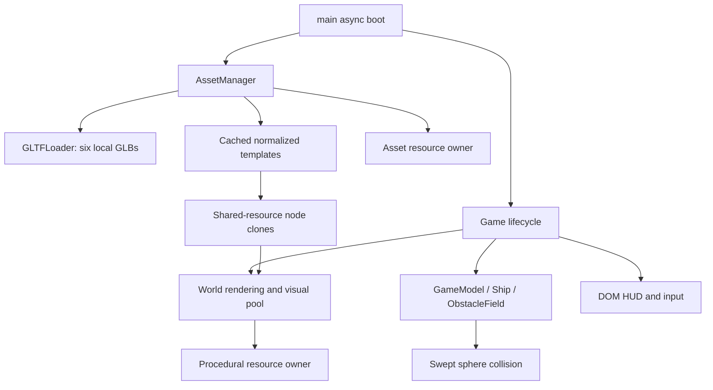

# Architecture review — PHASE-2-001

## Before this change

Baseline `e926a725eb8d6ed8a022235be9a50fe384fc8bdb` used strict TypeScript, Three.js 0.186.1 and Vite 8.3.5 with no framework or physics engine. `GameModel` owned explicit states, ship motion, health/shield and distance. `ObstacleField` pooled 72 logical sphere hazards and 8 safe-wave descriptors; seeded randomness determined waves. `GameLoop` stepped simulation at 120 Hz with a 100 ms frame clamp. `InputManager` handled keyboard and captured pointer drag. DOM `HUD`, safe `ScoreStorage`, and a standalone `PlatformAdapter` completed the run loop.

`World` constructed a procedural ship and three primitive hazard visuals in every pool slot, shared their geometries/materials, and rendered scrolling Points, guides and a planet. No asset-loading abstraction existed. `main.ts` synchronously constructed `Game`. Whole-scene traversal disposed deduplicated geometry/material sets at teardown.

## Actual changes and responsibilities

| Module | Responsibility / contract |
| --- | --- |
| `src/assets/catalog.ts` | Six model paths, normalization settings, five visual variants; pure selection from existing kind/phase without PRNG changes |
| `src/assets/asset-manager.ts` | Async GLTFLoader, in-flight promise cache, normalized templates, rigid model cloning, startup progress, contextual failures, cancellation-safe teardown |
| `src/assets/resources.ts` | Explicit deduplicated geometry/material/texture ownership, borrowed-resource exclusion, idempotent disposal, ImageBitmap closing if future textures use it |
| `src/main.ts` | Async boot/retry before Game creation, progress/error UI, development-only inspection, HMR cancellation/cleanup |
| `src/game.ts` | Receives loaded assets, transfers lifetime ownership, connects unchanged gameplay to World; disposes World before asset resources |
| `src/world.ts` | Borrows ship/hazard clones; retains procedural environment/feedback; tracks only its own GPU resources |
| `scripts/review-*.mjs`, `zip.mjs` | Reusable verification, static checks, committed snapshot/change reports/evidence packaging, readable ZIP verification |

## Loading, caching and failure lifecycle

Boot loads all six required GLBs concurrently. Each id is cached as an in-flight promise before a second caller can start another request. `preload` waits for all settlements so a failed startup cannot abandon successful sibling loads. The UI reports completed models; launch appears only after all are ready. A missing required asset blocks launch and offers Retry; retry creates a new owner after disposing the failed one. Error messages include the filename in console details and give an actionable visible summary.

Templates are centered using world-space bounds after the configured rotation. Ship width is 2.8; each hazard's furthest vertex has unit radius. Rigid scene-node cloning shares geometry/material references, while cloned transforms are independent. All selected assets are verified to have no skins/animations/images/external buffers. Skeleton cloning and compressed texture/mesh decoder support are deliberately absent because they are not required by these files.

On restart only run data and transforms reset: no fetch, normalization, material creation or listener registration occurs. World preallocates five model clones for each of 72 slots. This increases bounded scene-node count compared with the old three visuals per slot, while only the selected variant is visible. Model selection uses the existing kind/phase, so seeded waves, collider sizes and PRNG calls remain byte-for-byte unchanged.

## Resource ownership and disposal

`AssetManager.resources` owns imported geometry/materials/textures once for the Game lifetime. `World.resources` tracks procedural resources and excludes borrowed model sets. Neither deactivation, despawn nor restart disposes anything. `Game.dispose()` stops the loop, aborts listeners, disconnects ResizeObserver, disposes World-owned resources/renderer, then disposes assets. Main's HMR cleanup is idempotent. A model request that finishes after manager disposal immediately disposes its returned resources and rejects instead of repopulating a dead cache.

Selected GLBs are texture-free. Generic texture collection/Bitmap closing is included for ordinary material texture slots, but custom shader uniforms/complex future texture graphs would need additional ownership handling. A partially failed GLTFLoader parse can allocate internal parser resources before returning a scene; complete network-abort/parser cancellation is not implemented. Current valid GLBs and intentional 404/retry are tested.

## Collision and pooling boundaries

Core simulation, collision math, movement, input, difficulty and generation code are unchanged. The ship sphere stays radius 0.42; decorative wings extend beyond it. Hazard meshes remain inside their logical sphere after unit-radius normalization and uniform scaling. This preserves full-height corridor clearance/reachability. Sphere proxies intentionally approximate irregular objects and do not test triangles; small visual gaps on machinery are not navigable holes. Hollow scaffold structures were rejected in favor of solid barrel/generator debris.

## Verification and technical debt

Tests cover promise caching, independent transforms/shared resources, retry, late completion after dispose, ownership boundaries and all six real GLBs. Existing seeded reachability, collision, score and state tests remain. Chrome tests render every model, count exactly six GLB responses before and after five restarts, and compare warmed renderer geometry/texture counts. WebGL context restoration, failure/retry, touch, persistence and production requests are tested. GPU counts are a bounded regression signal, not a comprehensive heap/leak proof.

The restart fixture initially counted the first lazy impact-geometry upload as a leak (30→31). It now warms the burst before taking a baseline, and the death helper uses the actual remaining hull. Actual diagnostic logs are retained in the archive. No gameplay change was needed for these test corrections.

The single JS chunk includes mandatory Three.js/WebGLRenderer and GLTFLoader startup code. Build analysis records pre-minification module attribution; production measurements record actual bytes/gzip. Binary assets remain separate. No artificial chunk limit or build-system redesign was introduced.

Remaining debt: physical mobile/Safari/Firefox coverage, sustained GPU/heap profiling, audio, richer instancing if future model counts grow, generalized skinned/textured assets, and actual Yandex SDK integration. Phase 3 was not started. There is no known unresolved regression in tested flows; untested devices are not claimed supported by measurement.
