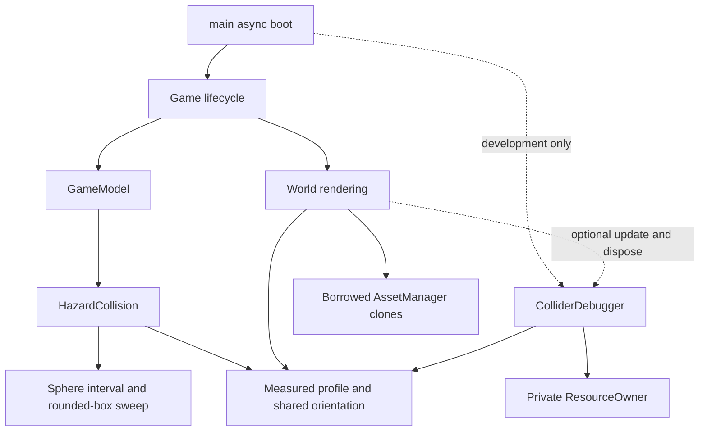

# Architecture changes — PHASE-3-001

## Baseline and scope

Approved main: `08ceed477a134757336589dc1feadae7606ca3e5`. Local main and fetched origin/main were synchronized; an existing feature branch at the same commit had no divergent work. This task changes only readability, measured collision proxies, developer diagnostics and current-task review evidence. No new dependency, downloaded asset, gameplay tuning, audio/effects or SDK work.

The baseline separated pure `GameModel`/`Ship`/`ObstacleField` from Three.js `World`, DOM HUD/input, shared GLTF `AssetManager`, score storage and platform seam. It used swept spheres for all hazards. World additionally rendered eight green safe-wave rectangles and nine closed blue decorative frames.

## Modules and boundaries

| Module | Change / responsibility |
| --- | --- |
| `core/hazard-profile.ts` | Pure measured box metadata, unchanged visual-variant mapping, shared Euler orientation and inverse rotation |
| `core/collision.ts` | Existing sphere helper plus sphere entry/exit interval and exact linear sphere-to-box CCD with rounded edges/corners |
| `core/hazard-collision.ts` | Reusable scratch state; round sphere path or simultaneous outer-sphere/rotating-box condition |
| `core/game-model.ts` | Calls the query using relative motion; existing health, shield, scoring, states and update ordering remain |
| `assets/catalog.ts` | Re-exports original variant function; six paths and normalization remain unchanged |
| `debug/collider-debugger.ts` | Development-only pooled wire visuals, model-aligned bounds, throttled diagnostics and owned-resource disposal |
| `debug/types.ts` | Erased interface/factory types; no production geometry dependency |
| `main.ts`, `game.ts`, `world.ts` | Guarded dynamic debugger import/factory, optional render/dispose lifecycle; remove green gate visuals and fragment/dim blue frames |
| Review scripts/config | Current task reports, screenshots, limitations and collision measurements; retain HEAD blobs, binary diff, secret/path checks and ZIP integrity verification |

## Collision policy and simulation

The two round meteors and approved player radius remain spheres. Three demonstrably thin variants add an oriented box derived from actual normalized GLB bounds. The original sphere remains mandatory, so effective reach cannot grow. Sphere and box overlap must occur within the same time interval. Rotation uses the midpoint orientation plus a conservative angular-motion allowance; linear motion is continuous, not endpoint-only.

Full numerical findings, formulas, evidence and conservative seam limitations are in `reports/COLLISION-CALIBRATION.md` (source `docs/COLLISIONS.md`) and generated `COLLISION-MEASUREMENTS.json`. Core code does not import Three.js, GLTFLoader or scene nodes. Bounds are static metadata, with tests against real GLBs. No new PRNG call or spawner branch was added; logical Wave descriptors stay intact.

## Rendering and ownership

Green `gates` allocation/update is removed entirely. Logical waves are no longer consulted by World. Blue frame positions/scrolling remain, but their outlines are reduced to dim disconnected corner marks so they no longer resemble enclosed checkpoints. Engine/planet/stars/health colors remain untouched.

Main creates the debugger factory only after loaded assets and only for development `debug=colliders`; Vite drops the dynamic module in production. Game passes the optional factory to World. World tracks its procedural resources before attaching debugger resources, so ownership does not overlap. The debugger uses two cached wire geometries/three materials, 72 reusable hazard slots and one player sphere; nothing is allocated on restart. Update changes existing transforms/visibility and formats text at four Hz. World disposes the view before its own renderer/resources, then Game disposes shared assets as before.

Tests check that the debug root identity, direct-child count, six GLB requests and warmed geometry/texture counts remain stable over five restarts, and that both wire geometries are disposed exactly once. Normal mode has no debug root/resources; production query tests also inspect the emitted script for the private module marker.

## Evidence integrity and remaining debt

Review text is now generated from the current configuration rather than fixed Phase 2 prose. Extra checks are limited to safe script paths, without shell interpolation. `collision-audit` writes current GLB measurements to the current task evidence directory. The ZIP still reads committed regular blobs, excludes sensitive/generated paths, scans known credentials, includes a binary-capable baseline patch, verifies CRC/content for every entry and checks a clean tree. Old reports in the source snapshot remain historical documents; current top-level reports/screenshots are PHASE-3-001 only.

No camera/input/ship/spawner/config changes; no production debug module; no model or cache ownership changes. Remaining limits: lightweight surface approximations, conservative rotating/seam contacts, intentionally forgiving decorative ship wings, physical mobile/Safari/Firefox and sustained performance coverage. GitHub merge remains a human/external-review decision.
